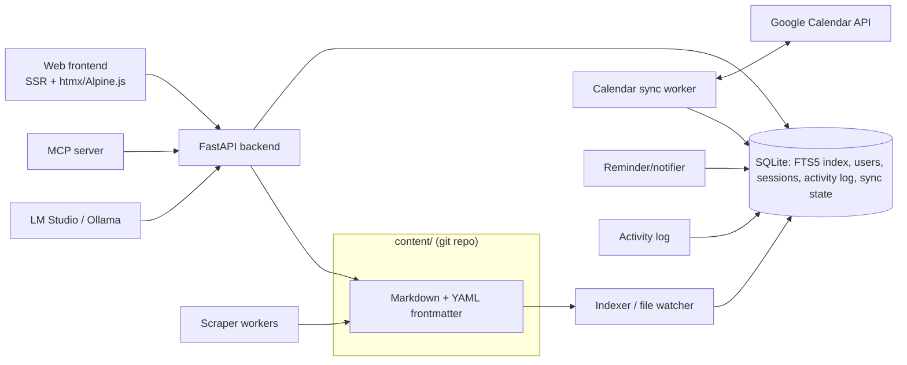

# MakerOS — Operating System for a Prototyping Lab

> Planning document. Feed this to Vibe CLI at project start: `vibe` → *"Read @docs/PLAN.md and let's start with Phase 0."*
> Principle: **Markdown is the source of truth.** Everything — projects, tasks, docs, exhibit tables — is plain Markdown files in a git repo. MakerOS indexes them into SQLite and renders a web UI on top. Data outlives the app.

## 1. Scope & Constraints

MakerOS is a **standalone, self-hosted, from-scratch web application** for the Centro de Ciencia FJC maker/prototyping lab. No third-party SaaS (no Notion, no Vikunja, no Trello). Dev libraries and frameworks are allowed; the product is ours, open source, and doubles as the lab's portfolio.

**Hard rules:**
- Markdown files + YAML frontmatter = storage format (git-friendly, no lock-in, survives the app).
- Single binary or single `docker compose up` deployment on one lab machine.
- Runs alongside LM Studio / Ollama on a 32 GB / GTX 1080 box — target < 500 MB RAM for MakerOS core.
- Accessible inside the university network and via Tailscale from outside.
- Spanish-first UI (team language), English code/comments.

## 2. Core Features

### 2.1 Projects
- Project = a directory: `content/projects/<slug>/project.md` (YAML frontmatter: name, status, lead, members, dates, repo URLs, tags).
- Markdown body = the project's living doc (objectives, notes, decisions, changelog).
- Statuses: `idea → planning → active → paused → done → archived`.
- Auto-generated index page listing all projects with status badges, owner, progress.

### 2.2 Tasks
- Tasks are Markdown checkboxes inside project files **and/or** standalone files: `content/tasks/<slug>.md`.
- Frontmatter: `project`, `assignee`, `due`, `priority`, `status`, `tags`, `depends_on`.
- Views (generated from frontmatter, never hand-maintained):
  - **Kanban** by status (drag & drop writes back to frontmatter).
  - **List** sorted by due date / priority / assignee.
- Assignment: person tags map to `content/people/<name>.md` (each person has a profile page with their tasks and projects).
- Recurring tasks (maintenance): `repeat: weekly|monthly` in frontmatter; MakerOS materializes the next instance on completion.
- My day view: everything due for the logged-in user, grouped by project.

### 2.3 Calendar (Google Calendar sync)
- Built-in calendar view rendering all dated items (task due dates, events, reminders).
- Events: `content/events/<slug>.md` with frontmatter `start`, `end`, `location`, `attendees`.
- **Google Calendar two-way sync** via Google's API (OAuth):
  - Each lab calendar (or a dedicated "MakerOS" calendar) syncs events both directions on a schedule + on change.
  - Task due dates can be pushed to GCal (opt-in per project).
- Also expose **CalDAV** so native calendar apps can subscribe without Google.
- Reminders: notification service checks due dates; delivers in-app + (later) email/Telegram.

### 2.4 Repository Hub (research library)
- `content/research/<slug>.md` per item: URL, title, type (repo/paper/article/video), tags, project link, one-paragraph summary, "why it matters".
- Saved-from-browser flow: bookmarklet / quick-add endpoint → MakerOS fetches title, description, favicon, and files the Markdown stub for triage.
- Full-text search across all research items (SQLite FTS5).
- Weekly digest: AI (local model) summarizes the week's saved items into a wiki page + Telegram/email.

### 2.5 CAUCE Exhibit Table
- `content/exhibits/cauce/devices/<device>.md`, one file per device.
- Frontmatter: `name`, `ip`, `ssh_user`, `ssh_port`, `mac`, `location`, `status`, `last_seen`, `responsible`.
- Body: operating instructions (Markdown), troubleshooting history, maintenance log (append-only dated entries).
- Generated overview table page: all devices, sortable, with **live status column** (ICMP/TCP ping from the server).
- Quick actions per device: copy SSH command, open internal web UI link.
- Related: `exhibits/cauce/rooms.md` for physical layout, network map.

### 2.6 Inventory (printers, laser cutter, tools)
- `content/inventory/<item>.md`: type, model, serial, location, condition, consumables.
- Usage/maintenance log per item (append entries: date, who, what).
- Low-consumable warnings (e.g., "laser tube hours > X").

### 2.7 Knowledge Wiki
- Free-form Markdown pages under `content/wiki/`, hierarchical, full-text search, backlinks.
- Templates: `device-doc`, `project-postmortem`, `howto`, `meeting-notes`.
- **Notion-style block UI (platform-wide):** every page is edited as a list of blocks (heading, paragraph, list, checklist, table, code, quote). Blocks map 1:1 to Markdown chunks; add/edit/delete writes back through the frontmatter module, so the file stays the source of truth. Category navigation lives in a sidebar; each category has an "+ Añadir" button that creates a page from its content template.

### 2.8 Accounts, Personal Space & Vault
- Every member has a **personal account** (Argon2 passwords) with a profile page; accounts are the identity anchor for task/project assignment, activity attribution (2.9), and notifications.
- Roles: admin / member / viewer; optional Tailscale-based trust (requests from tailnet skip login for read-only).
- **Per-user integrations ("my sync"):** each member connects their own services to their account — personal Google Calendar (their assigned tasks/due dates), Telegram for reminders, personal scraper watchlists. Tokens stored per-user in the vault, never in Markdown.
- **Personal space:** private notes and saved items live under `private/<user>/` — a Markdown tree sibling to `content/`, **excluded from the shared git repo**, indexed owner-only. Still plain Markdown, so no lock-in, but never exposed to other members or pushed to the shared remote.
- Encrypted **secret vault** for shared credentials (device SSH keys, API keys) — never in Markdown; AES-GCM at rest, unlock per-user with per-item ACLs. (Device *addresses* live in Markdown; *credentials* live here.)

### 2.9 Activity Tracking & Monthly Reports
- Every member action leaves a lightweight **activity record** in SQLite: task completed, task created, maintenance log entry, project status change, research item filed, event attended (who, what, when, which project).
- **Fully derived** — no manual logging. The indexer + API emit activity events automatically, so the record is trustworthy without anyone remembering to "log their work".
- **Personal activity page:** timeline per member (what I did, grouped by project, week/month).
- **Lab-wide activity feed** on the dashboard.
- **Monthly report generator:** one click produces a per-member monthly report as a Markdown draft (`content/wiki/reports/<year>-<month>-<user>.md`) — tasks done, projects advanced, maintenance performed, hours/events — ready to hand in as the monthly report. AI (2.10) can optionally draft the prose summary; the numbers are always computed, never generated.

### 2.10 AI Layer (local models)
- Config: `LLM_INTERACTIVE` and `LLM_BACKGROUND` endpoints (LM Studio / Ollama, OpenAI-compatible).
- Uses: research summarization, weekly digest, "ask the wiki" chat (RAG over FTS5 results), task drafting from meeting notes, prose drafts for monthly reports (2.9).
- Every AI feature degrades gracefully to a "model offline" state — MakerOS must work fully without any LLM.

### 2.11 Dashboard
- Home page: active projects, my tasks, calendar strip, device status colors, recent wiki edits, scraper digest preview, lab activity feed (2.9).
- Later/showcase: Three.js lab map (CAUCE rooms in 3D, device status as glowing markers) — portfolio piece.

### 2.12 Scraper (phase 2+)
- Python workers on a schedule (APScheduler): configured sources (arXiv queries, GitHub topics, YouTube channels, RSS), dedupe against existing research items, summarize with `LLM_BACKGROUND`, file as triage Markdown.

## 3. Architecture



- **Backend:** Python + FastAPI. Libraries allowed: `watchfiles` (file watcher), `markdown-it` / `mistune` (rendering), `pydantic` (frontmatter schemas), `APScheduler` (jobs), `httpx`, `python-frontmatter`.
- **Frontend:** server-rendered + htmx for interactivity (kanban drag-drop included) — avoids an SPA build chain; alternative if preferred: React + Vite.
- **Storage:** Markdown files (content), SQLite (index, users, sessions, activity log, sync state). SQLite means zero extra containers. Personal notes live in `private/<user>/` — same Markdown format, owner-only index, excluded from the shared git repo.
- **Auth:** FastAPI + session cookies; roles: admin / member / viewer. One account per member; all assignments, activity, and per-user integrations key off this identity.
- **Google sync:** google-api-python-client, OAuth installed-app flow, incremental sync (sync tokens) every N minutes.
- **AI:** OpenAI-compatible client pointed at LM Studio/Ollama.
- **MCP server** (phase 2): exposes `search_docs`, `get_device`, `list_tasks`, `create_task`, `get_activity`, `ask_wiki` tools so Vibe CLI / agents can operate the lab from the terminal.

### Content tree

```
content/
  projects/<slug>/project.md
  tasks/<slug>.md
  events/<slug>.md
  people/<name>.md
  research/<slug>.md
  exhibits/cauce/devices/<device>.md
  exhibits/cauce/rooms.md
  inventory/<item>.md
  wiki/<path>.md
  wiki/reports/<year>-<month>-<user>.md   (generated monthly reports)
private/<user>/          (per-member notes & saved items — owner-only, not in shared git)
templates/               (project.md, device.md, task.md ...)
```

## 4. Phases

| Phase | Deliverable | Est. |
|---|---|---|
| **0. Skeleton** | Repo, FastAPI app, Markdown indexing, FTS5 search, auth, basic wiki render | 1–2 wk |
| **1. Core** | Projects, tasks (kanban/list), people, per-user accounts + personal spaces, activity tracking + monthly report generator, dashboard v1 | 3 wk |
| **2. Exhibit & inventory** | CAUCE device table + live status, maintenance logs, inventory | 1–2 wk |
| **3. Calendar** | Events, reminders, Google Calendar sync, CalDAV out | 2 wk |
| **4. Research hub + vault** | Quick-add, research views, secret vault | 1–2 wk |
| **5. AI layer** | Summaries, digests, ask-the-wiki chat | 2 wk |
| **6. Polish & publish** | Scraper, Three.js dashboard, README for other labs, GitHub release | ongoing |

## 5. Tech Decisions

1. **Decided: htmx** (vendored locally, no CDN) for inline interactivity — block editing, later kanban drag & drop.
2. Task storage: standalone files only vs also inline `checklists` inside project docs (recommend: both, indexer normalizes).
3. Google sync scope: one shared lab calendar vs per-project calendars vs bidirectional personal calendars (recommend: dedicated MakerOS calendar + task-due push).
4. **Decided: Spanish-only UI** (strings centralized in templates for a future i18n pass).
5. Deployment target: bare Docker vs single binary (PyInstaller) — recommend Docker Compose with two services (app + Caddy for TLS inside the tailnet).

## 6. Non-Goals (v1)

- No mobile app (web is responsive).
- No email server (use Telegram bot or defer).
- No multi-tenant / multiple labs — single lab instance.
- No real-time collaborative editing (git + last-write-wins with conflict warning).